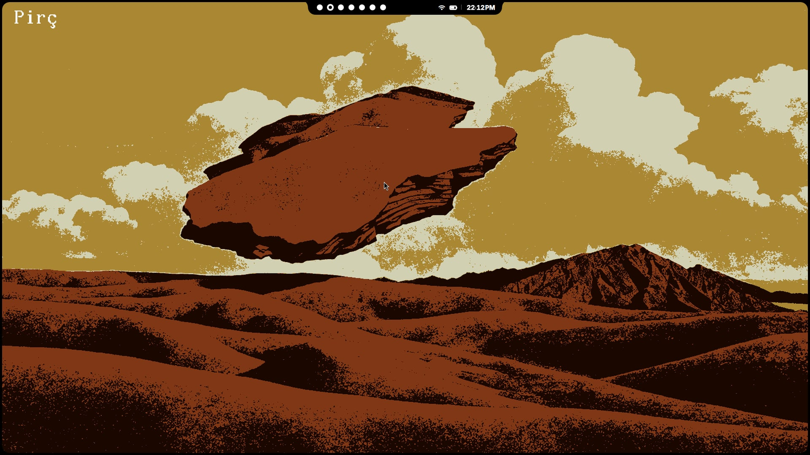
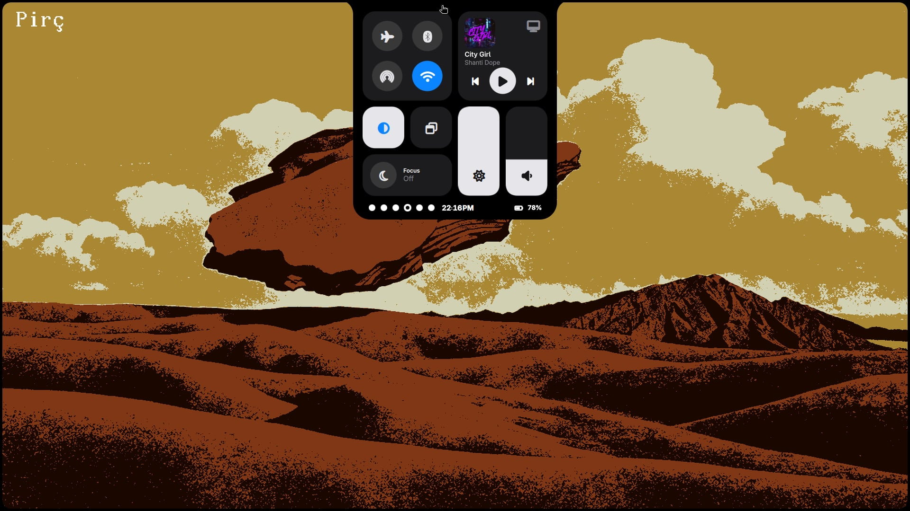
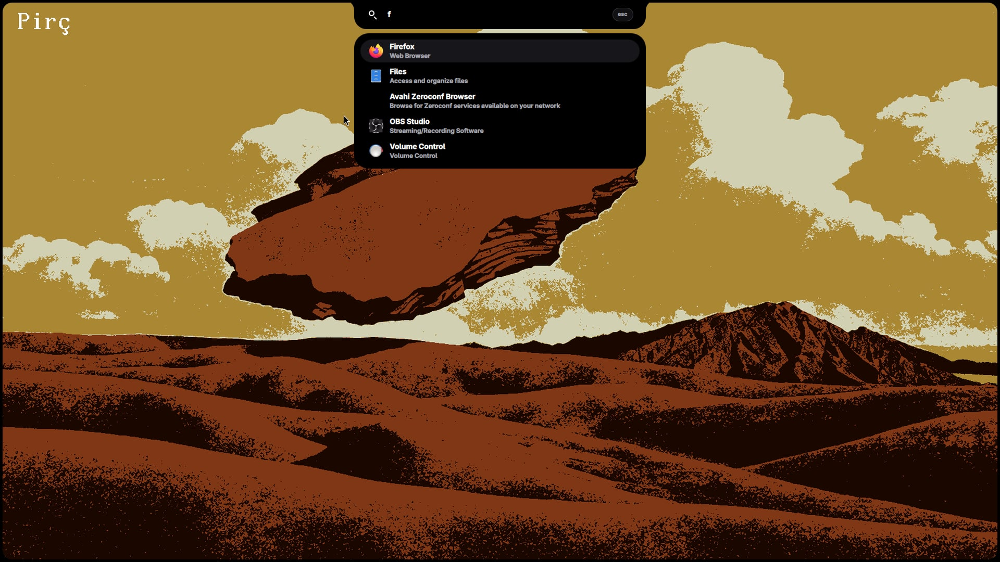
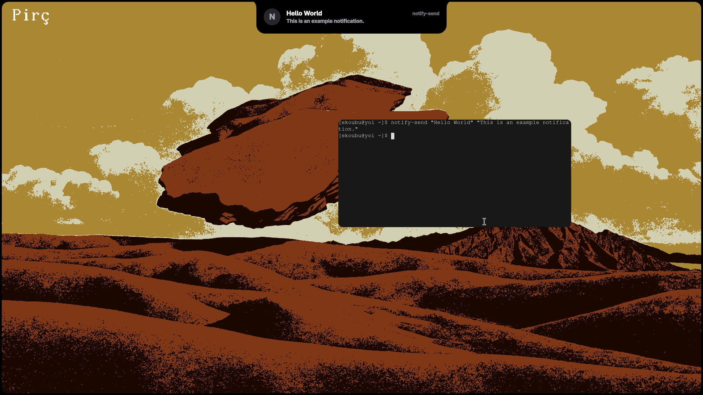
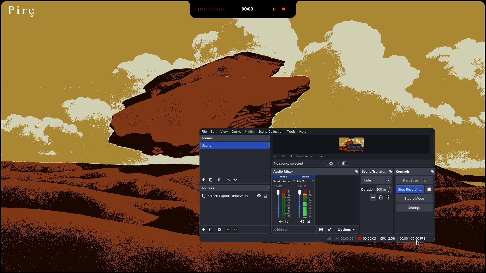

# Collections — Bars

A collection of custom desktop bars and UI components I've built as personal experiments, productivity tools, and design explorations.

---

# Overcast

designed to provide quick access to essential information and actions.

## Preview

https://github.com/user-attachments/assets/a5f1be51-cdbf-4eaa-8904-fc6ab913242d

> Overcast is primarily a personal project and an ongoing experiment in desktop interface design.

---

# Tahoe-Shell - WIP

i made this because i honestly like the UI of macOS Tahoe and also to design what tahoe must be (base on my opinion btw).

## Preview

https://github.com/imhannsop/bars/raw/main/tahoe-shell/images/prev.mp4

<video src="./tahoe-shell/images/prev.mp4" controls="controls" width="100%"></video>

[▶ Watch Preview Video (prev.mp4)](./tahoe-shell/images/prev.mp4)

## Screenshots

### Default (Non-expanded)

### Expanded ver

### App Search

### Notification Center

### Screen Recording Notification

